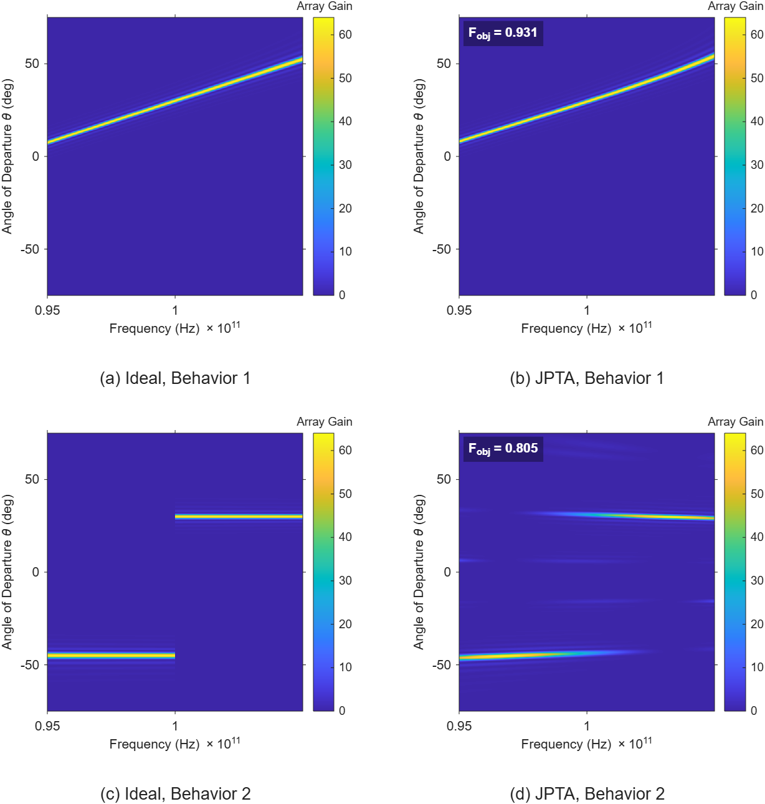
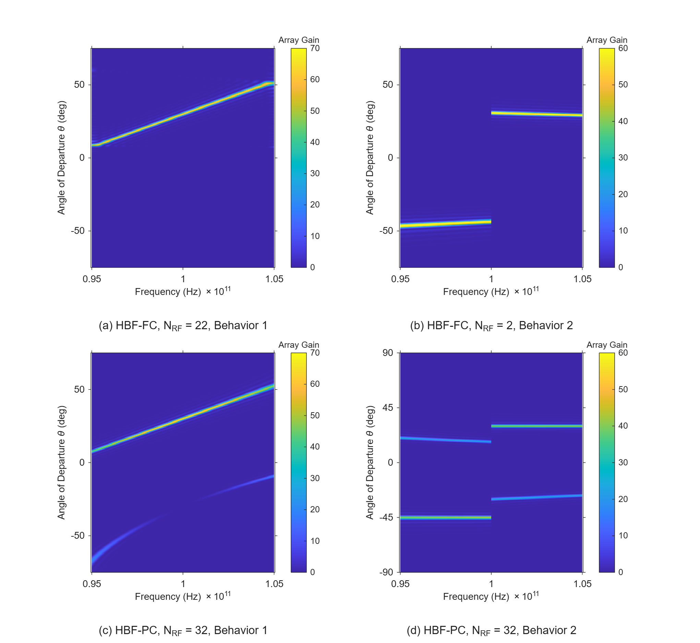
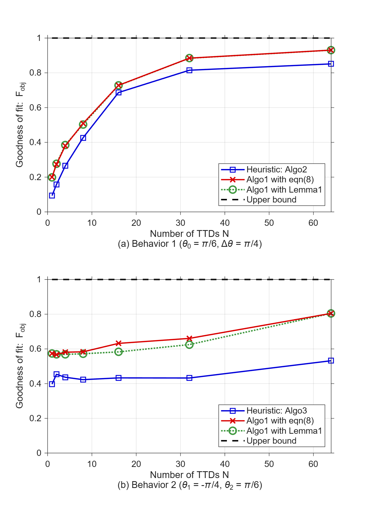
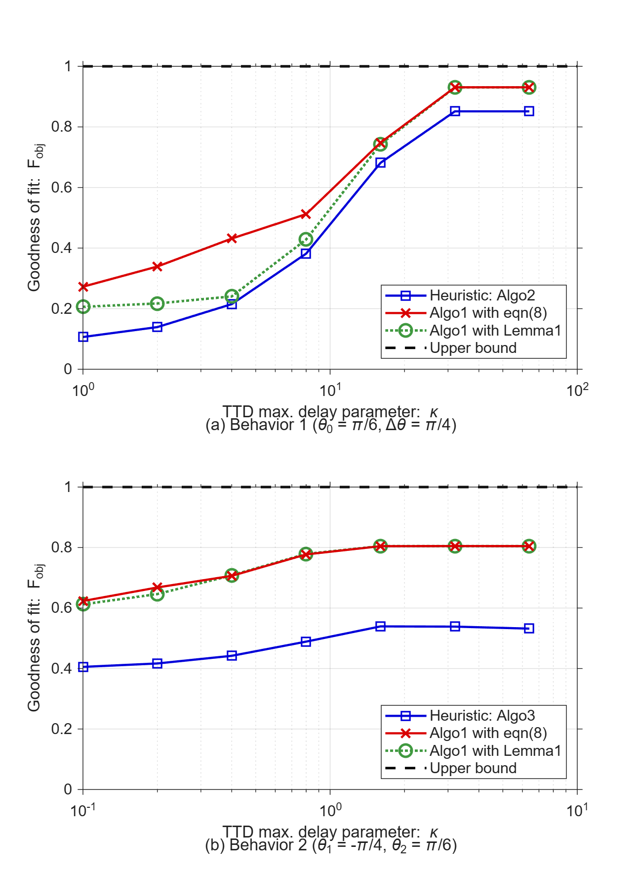
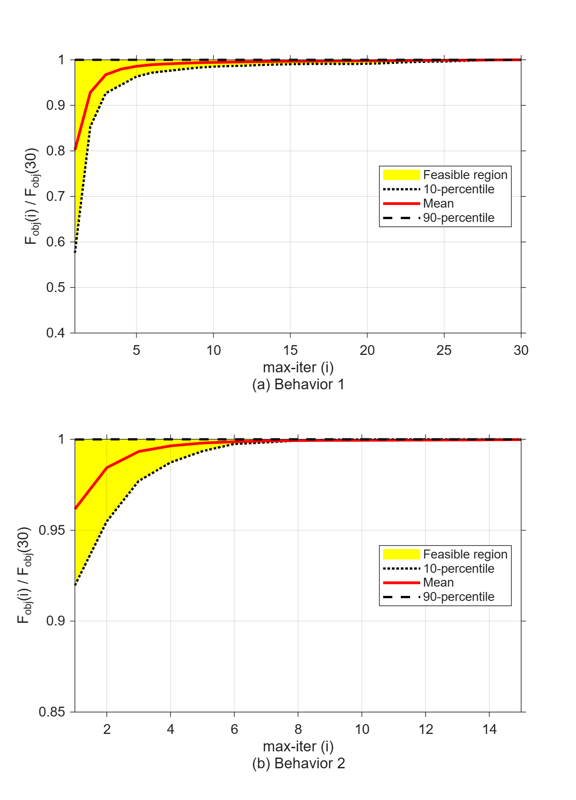
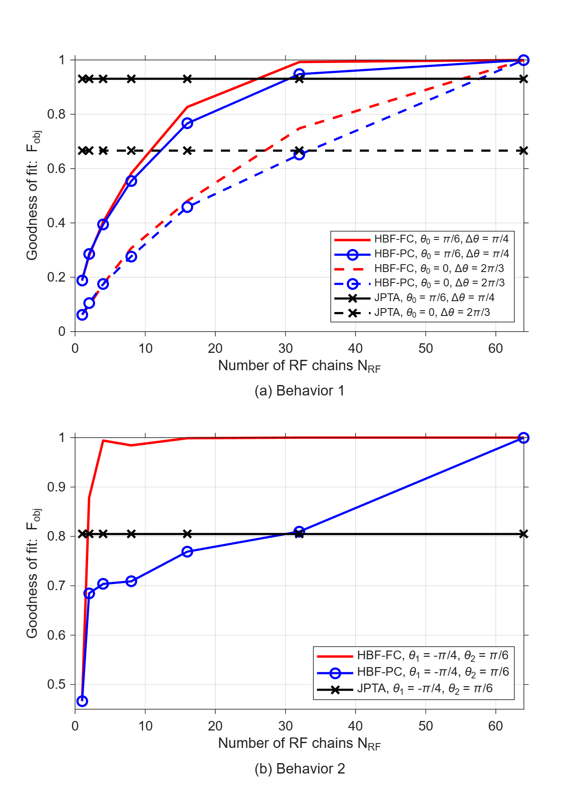

# JPTA2022

[中文](README.md) | English

MATLAB reproduction of all simulation results in:

> V. V. Ratnam, J. Mo, A. Alammouri, B. L. Ng, J. Zhang, A. F. Molisch,
> "Joint Phase-Time Arrays: A Paradigm for Frequency-Dependent Analog Beamforming in 6G",
> *IEEE Access*, vol. 10, pp. 73364–73377, 2022.

Joint Phase-Time Arrays (JPTA) add one true-time-delay (TTD) line to each branch of a
conventional phase-shifter array, so that the analog beam direction becomes
frequency-dependent and a **single RF chain** can approximate the ideal beam over the
whole band. This repository provides an independent implementation of every simulatable
result in the paper (Figs. 4–7, 9, 10), point-by-point numerical comparisons, and notes
on the implementation.

> **How this was produced**: the simulation code, all numerical results and the
> documentation in this repository were produced with **DeepSeek-V4.1-Flash**, without
> access to the authors' original code. Every figure was checked against the paper;
> the remaining discrepancies are listed in [`REPORT.en.md`](REPORT.en.md) §7.2.

- Result report (per-figure tables, typos in the paper, implementation pitfalls): [`REPORT.en.md`](REPORT.en.md) ([中文](REPORT.md))
- Simulation code: [`matlab/`](matlab/)
- Paper PDF: `Ratnam 等 - 2022 - Joint Phase-Time Arrays A Paradigm for Frequency-.pdf`

---

## 1. Summary of results

| Figure | Content | Outcome |
|---|---|---|
| Fig. 4 | JPTA array-gain heat maps (behaviors 1/2, `N=M`, `κ=M`) | Same four-panel structure; `Fobj` = **0.9307** / **0.8047** (paper ≈ 0.93 / 0.80) |
| Fig. 5 | `Fobj` vs `N`, 3 algorithms × 2 behaviors | Matches point by point, max deviation 0.02 (0.03 for the heuristic curve) |
| Fig. 6 | `Fobj` vs `κ`, 3 algorithms × 2 behaviors | Matches point by point; both saturation points `κ=32` and `κ≈1.6` reproduced |
| Fig. 7 | Convergence percentile band (100 random realizations) | Shape and conclusion agree; `i=1` percentile is about 0.07 high (sampling distribution assumed) |
| Fig. 9 | HBF-FC/PC array-gain heat maps | Same four-panel structure, including the two-segment PC beam and weak mirror lobe |
| Fig. 10 | `Fobj` vs `N_RF`, FC/PC with JPTA references | FC curve matches; all three JPTA reference lines reproduced exactly |

All three core claims of the paper are supported:

1. JPTA already beats a pure phase-shifter beam with `N=1` TTD lines, and `Fobj` rises
   monotonically to 0.93 as `N` grows;
2. to reach the same beam quality, HBF-FC needs about **22** RF chains and HBF-PC about
   **32**, whereas JPTA needs only **1**;
3. the alternating optimization of Algorithm 1 reaches its plateau in 3–5 iterations, so
   `max-iter = 10` is a conservative choice.

---

## 2. Quick start

```matlab
cd matlab
run_all            % self-test + six figures, about 20 min
```

Running a single figure (an existing `out/*.mat` cache is reused, so only the plot is redrawn):

```matlab
run_all('selftest')   % invariants, upper bound, eq. (8a) peak, convergence
run_all('fig4')       % array-gain heat maps           ~3 min
run_all('fig5')       % Fobj vs N                      ~1.5 min
run_all('fig6')       % Fobj vs kappa                  ~1.5 min
run_all('fig7')       % convergence, 100 realizations  ~13 min
run_all('fig9')       % HBF array-gain heat maps       ~2 min
run_all('fig10')      % Fobj vs N_RF                   ~4 min
```

All parameters live in `cfg_default.m` and any field can be overridden on the fly
(`run_all` puts `core/`, `alg/` and `figs/` on the search path, so the low-level
functions can be called directly afterwards):

```matlab
cfg = cfg_default('N', 16, 'kappa', 32);
fig4_arraygain(cfg);
```

**Environment**: MATLAB R2022a or later (uses `tiledlayout` and `clim`); no parallel
toolbox is required, everything is vectorized and runs single-threaded. Verified on
R2026b. The random seed is fixed (`rng(1)`), so results are reproducible.

---

## 3. Repository layout

```
matlab/
  cfg_default.m          parameter table (Sec. VII), supports cfg_default('N',16,'kappa',32)
  selftest.m             self-test: norms, Cauchy-Schwarz bound, eq. (8a) peak, convergence
  run_all.m              single entry point, dispatches per figure
  core/
    build_map.m          mapping matrix P of eq. (1) (M×N, one 1 per row)
    array_resp.m         array response a_k(θ) of eq. (2)
    gen_beam.m           desired beams {b_k} (behaviors 1/2)
    jpta_forward.m       forward model T·P·d_k — the only "physical" implementation
    fobj.m               Fobj of eq. (12)
    array_gain.m         array gain |a_k(θ)†x_k|²
    hbf_fc.m             PE-AltMin of eqs. (13)(14) (fully connected)
    hbf_pc.m             alternating minimization under the block-diagonal constraint
  alg/
    solve_tau_ls.m       line search of eq. (8a) (FFT grid + parabolic interpolation)
    solve_tau_wls.m      phase unwrapping + weighted least squares of Lemma 1
    solve_phi.m          eq. (8b)
    update_alpha.m       eq. (11)
    alg1_jpta.m          Algorithm 1 (alternating optimization)
    alg2_heur1.m         Algorithm 2 (behavior-1 heuristic)
    alg3_heur2.m         Algorithm 3 (behavior-2 heuristic)
  figs/                  six figure scripts, one per figure in the paper
  out/                   output PNGs (tracked) and .mat caches (ignored)
REPORT.md                reproduction report: per-figure tables, typos, pitfalls
README.en.md             this file
REPORT.en.md             English version of REPORT.md
```

The forward model is implemented exactly once, in `jpta_forward.m`, and every algorithm
and every figure calls it. This rules out a whole class of silent bugs such as "Fig. 4 and
Fig. 5 use slightly different array-response conventions".

---

## 4. Simulation parameters

The parameters of Sec. VII, all collected in `cfg_default.m`:

| Symbol | Meaning | Value |
|---|---|---|
| `f0` | carrier frequency | 100 GHz |
| `W` | system bandwidth | 10 GHz |
| `K` | number of subcarriers | 2048 |
| `f_k` | subcarrier frequencies | `100+10k/K` GHz, i.e. 95–105 GHz |
| `M` | number of antennas (half-wavelength spacing) | 64 |
| `N` | number of TTD lines (`N≤M`) | 64 (swept 1–64 in Fig. 5) |
| `κ` | TTD delay range `[0,κ/W]` | 64 (swept 1–64 in Fig. 6) |
| `maxiter` | iterations of Algorithm 1 | 10 |
| `Nfft` | τ grid of eq. (8a) | 32768 (6.25 ps) |

Two beam behaviors:

- **Behavior 1 (continuous scan)**: `θ(f)=θ0+(f-f0)Δθ/W` with `θ0=π/6`, `Δθ=π/4`; the
  main lobe sweeps continuously from `7.5°` to `52.5°` across the band.
- **Behavior 2 (frequency reuse)**: the lower band points at `θ1=-π/4` and the upper band
  at `θ2=π/6`, with a step at the band center.

---

## 5. Typos in the paper

Four places in the paper must be corrected according to the derivations, otherwise the
numerical results cannot match (details in [`REPORT.en.md`](REPORT.en.md) §4):

| Location | As printed | Should be | Why |
|---|---|---|---|
| Algorithm 3, `e_b` | both terms use `e^{jπm sinθ2}` | second term should use `sinθ1` | otherwise it degenerates to a single beam and the step structure of behavior 2 disappears |
| Sec. VII | `Fobj` saturates after `κ=M sin(Δθ)` | `M sin(Δθ/2)` | Remark 2 gives M\|sin(Δθ/2)\|/W, and M sin(Δθ)≈2×24.5 |
| Sec. VII | behavior 2 saturates after `κ=2` | `κ=3` | Remark 2 gives `3/W`; the saturation in Fig. 6(b) lies between 2 and 3 |
| Proposition 1 | "22 RF chains" in the text | eq. (15) gives 23 | the narrowband approximation of eq. (19) does give 22 |

Two further items are **not typos, but implementing them literally fails**:

- `0≤τ_n≤κ/W` in Algorithm 1 should be read as the final hardware range, obtained by a
  centering shift. The line search must use the symmetric interval `[-κ/2W, κ/2W]` of
  eq. (4); otherwise the behavior-1 peak (negative τ) falls outside the interval and
  `Fobj` drops from 0.93 to 0.67 with oscillating iterations.
- The hook symbol in the Algorithm 3 pseudocode is the **phase operator `∠`**, not a
  multiplication or division sign. The PDF text layer extracts it as `̸`.

---

## 6. A quantitative note on `κ`

Sec. VII of the paper uses `κ=M=64`, i.e. a maximum TTD delay of `6.4 ns`. The delay span
actually required by behavior 1 can be derived exactly. The target phase of antenna `m` at
subcarrier `f` is `ψ_m(f)=(m-1)π sinθ(f)·f/f0`, while each JPTA branch has only two knobs:
a phase shifter (constant `φ_m`) and a TTD (slope `-2πτ_n f`). Hence only
"constant + linear" can be matched, and the key quantity is the **in-band phase span**:

```
Δψ_m = (m-1)π/f0 · [ sin(θ0+Δθ/2)·f_max − sin(θ0-Δθ/2)·f_min ]
κ_req ≜ τ_max·W = (M-1)/2 · | sin(θ0+Δθ/2)(f_max/f0) − sin(θ0-Δθ/2)(f_min/f0) |
```

For this setup (`θ0=π/6`, `Δθ=π/4`, `M=64`), several estimates compare as follows:

| Quantity | Expression | Value |
|---|---|---|
| **exact requirement** | the formula above (`M-1=63`, true band edges) | **22.3** |
| narrowband approximation | `M cosθ0 sin(Δθ/2)` | 21.2 |
| Remark 2 upper bound | `M sin(Δθ/2)` (drops `cosθ0`) | 24.5 |
| phase difference between the two edge angles | M\|sin(θ0+Δθ/2)−sin(θ0−Δθ/2)\| | 42.4 (a common mistake) |
| as printed in the text | `M sin(Δθ)` | 45.3 |

`τ_m·W` grows strictly linearly with `m` (slope 0.354), so `κ` is "the requirement of the
outermost antenna" — neither the array average nor the phase difference between the two
edge angles. The numbers in Fig. 6(a) confirm this: the curves for `κ=32` and `κ=64`
coincide, so the saturation point lies in `(16,32]`.

**Engineering implication**: behavior 1 needs only about `2.2 ns` of TTD (`κ≈22`), while
the paper uses `κ=M`, i.e. `6.4 ns` — roughly a 3× hardware margin. The maximum-delay
specification of a TTD can therefore be designed as `M sin(Δθ/2)/W` instead of copying `M/W`.

---

## 7. Reproduction results

<table>
<tr>
<td align="center"><br><sub>Fig. 4 — JPTA array gain (behaviors 1 and 2)</sub></td>
<td align="center"><br><sub>Fig. 9 — HBF-FC and HBF-PC array gain</sub></td>
</tr>
<tr>
<td align="center"><br><sub>Fig. 5 — Fobj vs number of TTD lines N</sub></td>
<td align="center"><br><sub>Fig. 6 — Fobj vs delay range κ</sub></td>
</tr>
<tr>
<td align="center"><br><sub>Fig. 7 — percentile band of Algorithm 1 convergence</sub></td>
<td align="center"><br><sub>Fig. 10 — Fobj vs number of RF chains N_RF</sub></td>
</tr>
</table>

### 7.1 Key numbers

`Fobj` of the three algorithms at `N=M=64` (`κ=M` in Fig. 6):

| Algorithm | Behavior 1 | Paper | Behavior 2 | Paper |
|---|---|---|---|---|
| line search, eq. (8a) | 0.9307 | 0.93 | 0.8047 | 0.81 |
| Lemma 1 (eq. 10a) | 0.9306 | 0.93 | 0.8049 | 0.81 |
| heuristics (Algorithms 2/3) | 0.8514 | 0.855 | 0.5319 | 0.565 |

Lemma 1 and eq. (8a) coincide to within 0.001, reproducing the paper's claim that Lemma 1
cuts the complexity substantially while barely reducing `Fobj`.

The three JPTA reference lines of Fig. 10 (`N=64`, `κ=64`):

| Scenario | Reproduced | Paper (read from figure) |
|---|---|---|
| behavior 1, `θ0=π/6`, `Δθ=π/4` | 0.9307 | 0.93 |
| behavior 1, `θ0=0`, `Δθ=2π/3` | 0.6661 | 0.666 |
| behavior 2 | 0.8047 | 0.805 |

### 7.2 Known deviations

Three readings differ from the paper. In all three cases the cause is information the paper
does not provide, not an implementation error:

1. **The `i=1` percentile in Fig. 7 is about 0.07 high.** The paper does not state the
   distribution of the random parameters. This implementation draws
   `N∈{1,2,4,8,16,32,64}`, `κ∈[1,M]`, `θ0∈[-π/3,π/3]`, `Δθ∈[0,π/2]`, which is a mild
   distribution, so the first iteration is already reasonably good. The shape and the
   conclusion agree; the absolute values depend on the sampling assumption.
2. **The `N_RF=1` point in Fig. 10.** FC and PC both degenerate to a purely analog beam
   there, and a single beam can serve only one of `θ1`, `θ2`, so `Fobj` is bounded by 0.5
   (this implementation gives 0.466). The paper reads 0.62–0.67, above that bound, and the
   paper itself has FC(1)≠PC(1) — yet the two feasible sets are identical at `N_RF=1`, so
   the values must be equal.
3. **PC behavior 1 in Fig. 10 is about 0.2 above the paper for `N_RF=2…16`.** The paper
   does not disclose the initialization. Selecting solutions by the Frobenius residual of
   eq. (14) alone lands consistently on a suboptimal point, so this implementation selects
   by `Fobj` instead (otherwise PC behavior 2 stalls at 0.51 versus 0.692 in the paper).
   The price is that behavior 1 is better than the paper in the mid range.

---

## 8. Pitfalls

In the order they were hit; the full list is in [`REPORT.en.md`](REPORT.en.md) §5:

1. **The line-search interval of eq. (8a) must be symmetric.** The delays required by
   behavior 1 are negative (`τ_m≈-(m-1)sinθ0/(2f0)`, about `-2.1 ns` for `m=64`), so
   searching over `[0,κ/W]` stops on a sidelobe.
2. **The full candidate grid of eq. (8a) can be evaluated with a single FFT.** The carrier
   part of `e^{-j2πf_kτ}` is a common phase independent of `m,k` and vanishes in the
   magnitude, leaving exactly the FFT bins. The prerequisite is that `f0·K/W=20480` is an
   integer.
3. **The normal equations of Lemma 1 require frequency centering and normalization**
   (`x=2π(f−mean(f))/max|·|`). Otherwise `2πf` reaches 6.6e11 while the in-band relative
   variation is only 10%: slope and intercept become almost collinear, `RCOND≈1e-21`, and
   MATLAB reports a nearly singular matrix.
4. **Do not select HBF solutions by the Frobenius residual alone.** For the PC structure,
   "all subarrays pointing the same way" and "subarrays sharing the directions" give
   almost identical residuals but differ by 0.2 in `Fobj`.
5. **In Figs. 5 and 6 the legend order differs from the data-column order**, so an index
   map is required before assigning handles; otherwise the legend labels are mismatched.
6. **Leave a decade of headroom on the Fig. 6 x-axis**, otherwise the rightmost sample
   sits on the frame and the `10^2` tick is not drawn.
7. **MATLAB details**: `-batch` runs on a GBK console, so Chinese text printed with
   `fprintf` is lost — all console output is ASCII; `TiledChartLayout.Padding` only accepts
   `loose|compact|tight` in R2026b; `clim` replaces the deprecated `caxis`.

---

## 9. Self-test

`selftest.m` checks the following invariants on every run. Since `Fobj∈[0,1]`, it doubles as
a unit test — any value above 1 is immediately a bug:

| Check | Result |
|---|---|
| `‖a_k(θ)‖²=M` | error 0 (exact) |
| `‖T P d_k‖=1` | error 0 (exact) |
| `Fobj` of the ideal beam | 1.0000 (exact) |
| `Fobj≤1` over 50 random parameter sets | all satisfied (Cauchy–Schwarz bound) |
| correctness of the eq. (8a) peak | no TTD improves after a ±80 ps perturbation |
| convergence | plateau after 3 iterations, 10 is enough |

---

## 10. Not covered

- Fig. 8 is an HBF architecture sketch, Table 1 is analytical and Table 2 is quoted data;
  none of them needs simulation.
- The multi-RF-chain JPTA discussed at the end of Sec. V (listed as future work) is out of
  scope.

---

## Citation

```bibtex
@article{ratnam2022jpta,
  title   = {Joint Phase-Time Arrays: A Paradigm for Frequency-Dependent
             Analog Beamforming in {6G}},
  author  = {Ratnam, Vishnu V. and Mo, Jianhua and Alammouri, Ahmad and
             Ng, Boon Loong and Zhang, Jianzhong and Molisch, Andreas F.},
  journal = {IEEE Access},
  volume  = {10},
  pages   = {73364--73377},
  year    = {2022},
  doi     = {10.1109/ACCESS.2022.3190418}
}
```

This is an independent implementation; the authors' original code was not used. Every
discrepancy with the published numbers is listed in [`REPORT.en.md`](REPORT.en.md).
