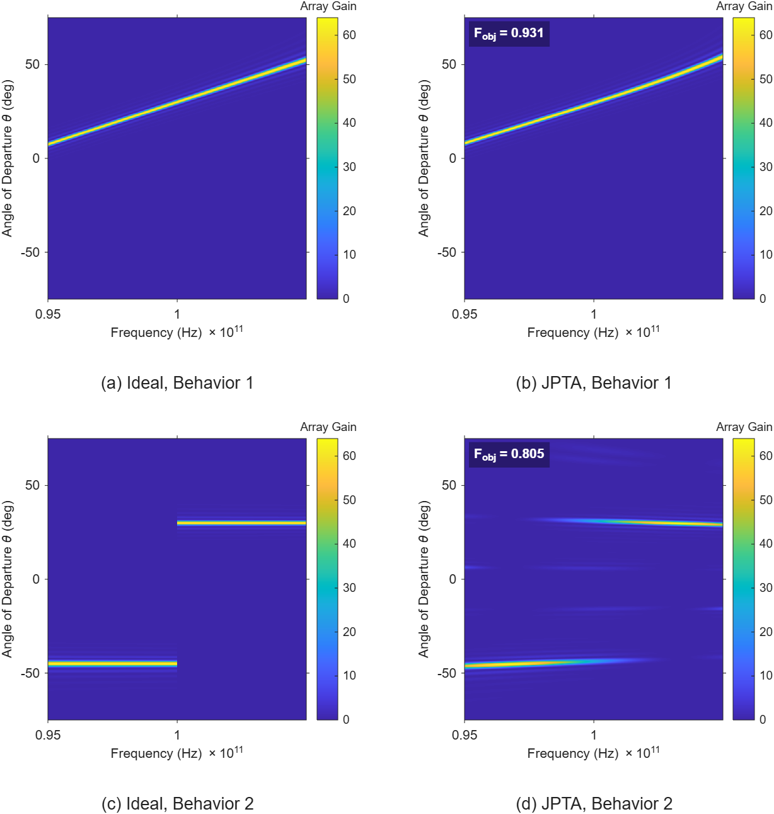
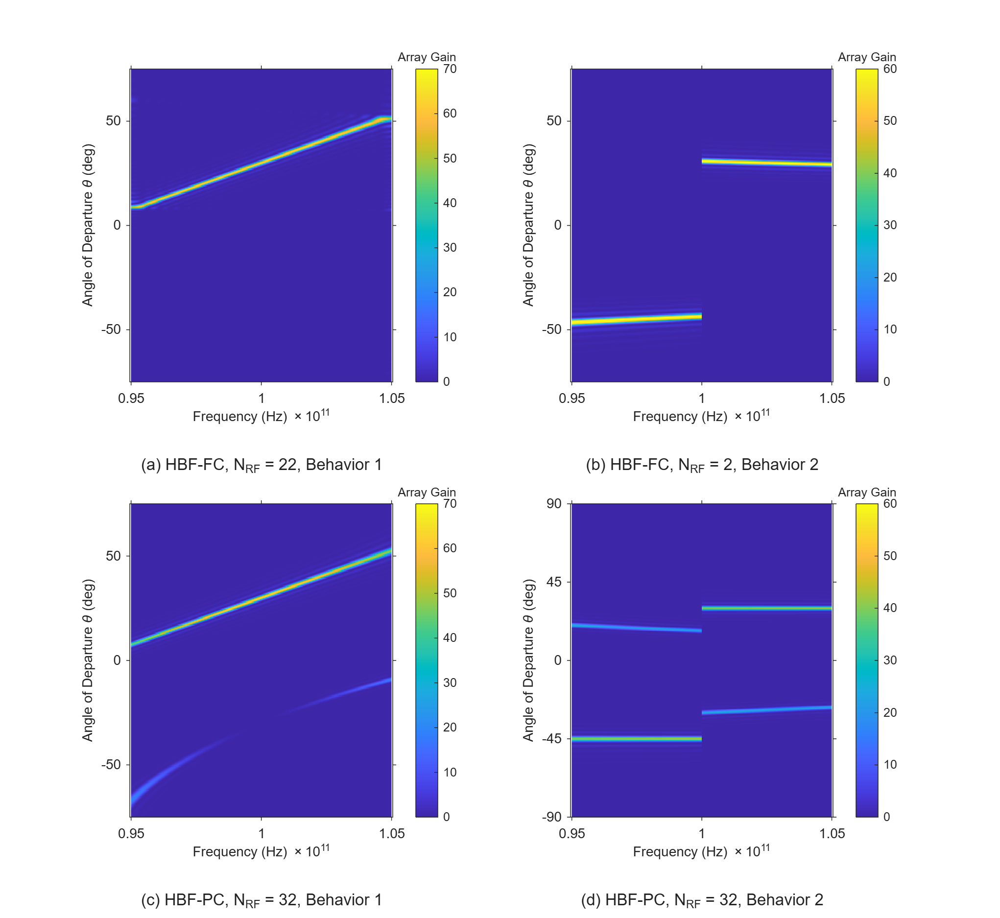
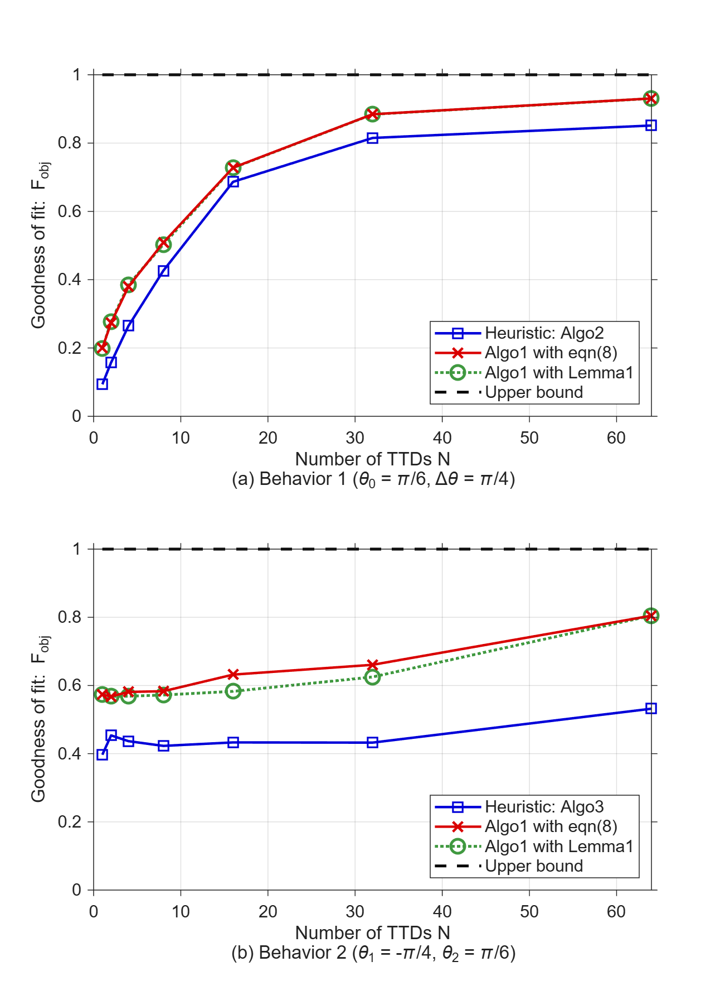
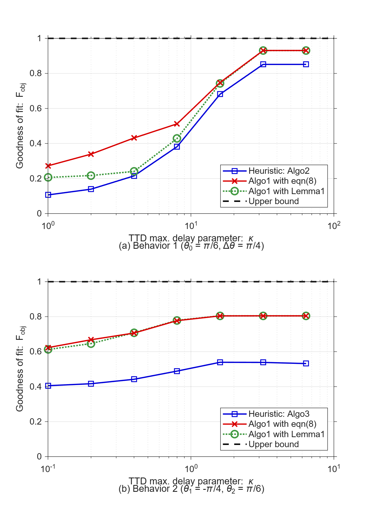
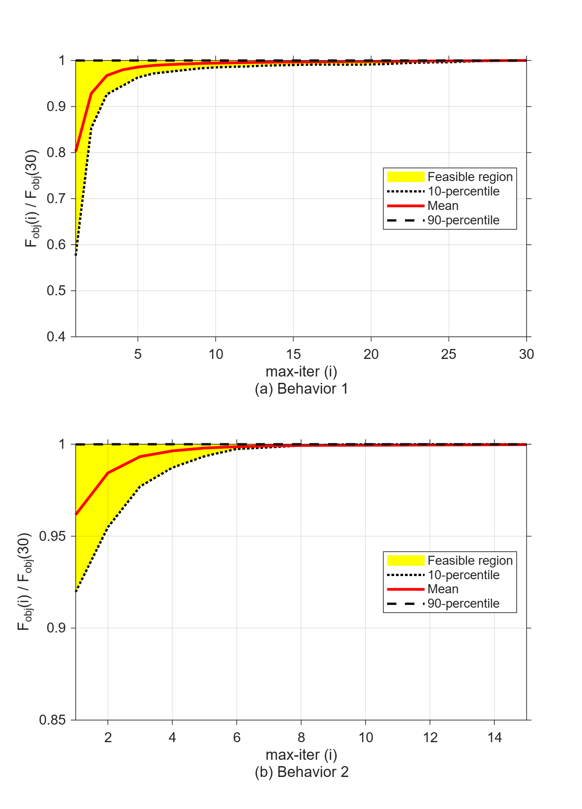
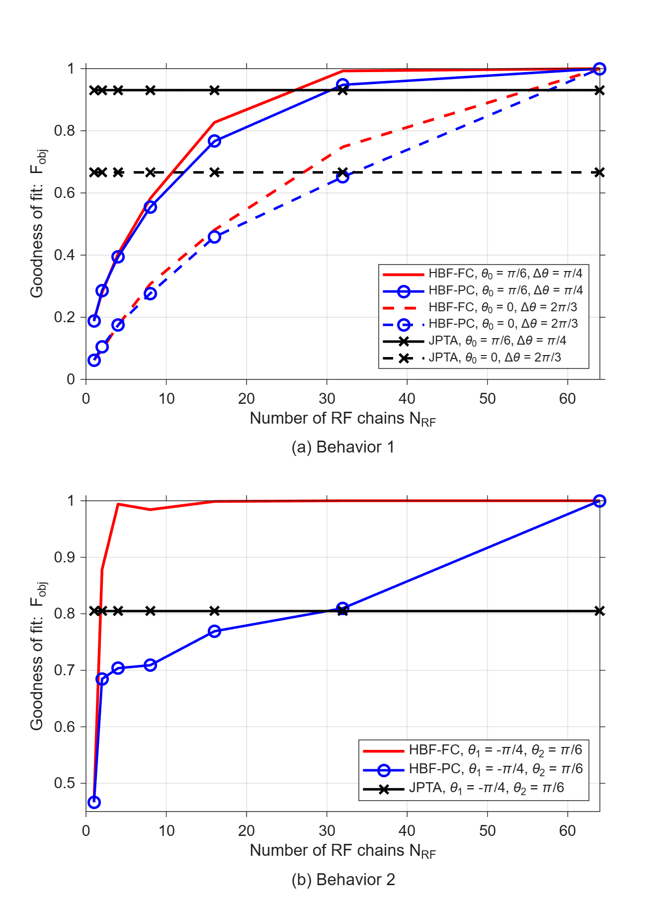

# JPTA2022

[English](README.md) | 中文

用MATLAB复现以下论文的全部仿真结果：

> V. V. Ratnam, J. Mo, A. Alammouri, B. L. Ng, J. Zhang, A. F. Molisch,
> "Joint Phase-Time Arrays: A Paradigm for Frequency-Dependent Analog Beamforming in 6G",
> *IEEE Access*, vol. 10, pp. 73364–73377, 2022.

Joint Phase-Time Arrays（JPTA）在传统移相阵列的每条支路上加一段真时延（TTD），
使模拟波束的指向可以随频率变化，从而用**一条RF链**在宽带内逼近理想波束。
本仓库给出论文全部可仿真结果（图4–图7、图9、图10）的独立实现、
逐点数值对照与实现说明。

> **实现方式**：本仓库的仿真代码、全部数值结果与文档由**DeepSeek-V4.1-Flash**完成，
> 未参考作者原始代码。各图数值已与原文逐项核对，不一致处见[`REPORT.zh.md`](REPORT.zh.md)第3节。

- 结果报告（逐图数值表、论文笔误、实现陷阱）：[`REPORT.zh.md`](REPORT.zh.md)（[English](REPORT.md)）
- 仿真代码：[`matlab/`](matlab/)
- 论文PDF：`Ratnam 等 - 2022 - Joint Phase-Time Arrays A Paradigm for Frequency-.pdf`

---

## 1. 结论速览

| 图 | 内容 | 复现结论 |
|---|---|---|
| 图4 | JPTA阵列增益热图（行为1/2，`N=M`，`κ=M`） | 四面板形态一致；`Fobj`=**0.9307** / **0.8047**（原文≈0.93 / 0.80） |
| 图5 | `Fobj`–`N`，3算法×2行为 | 逐点吻合，最大偏差0.02（启发式曲线0.03） |
| 图6 | `Fobj`–`κ`，3算法×2行为 | 逐点吻合；饱和点`κ=32`与`κ≈1.6`均复现 |
| 图7 | 收敛分位带（100组随机实现） | 形状与结论一致；`i=1`分位偏高约0.07（采样分布自定） |
| 图9 | HBF-FC/PC阵列增益热图 | 四面板形态一致，含PC的双段与弱镜像瓣 |
| 图10 | `Fobj`–`N_RF`，FC/PC/JPTA参考 | FC曲线与三条JPTA参考线精确吻合 |

论文的三个核心论断均得到支持：

1. JPTA用`N=1`条TTD支路即可优于纯移相波束，`N`增大时`Fobj`单调上升到0.93；
2. 达到同等波束质量，HBF-FC需约**22条**RF链、HBF-PC需约**32条**，而JPTA只要**1条**；
3. 算法1的交替优化3–5次迭代即进入平台，`max-iter=10`是保守取值。

---

## 2. 快速开始

```matlab
cd matlab
run_all            % 自检 + 六张图，约20 min
```

单图运行（已跑过的图会读`out/*.mat`缓存，只重绘）：

```matlab
run_all('selftest')   % 自检：范数、上界、式(8a)峰值、收敛性
run_all('fig4')       % 阵列增益热图            ~3 min
run_all('fig5')       % Fobj vs N               ~1.5 min
run_all('fig6')       % Fobj vs kappa           ~1.5 min
run_all('fig7')       % 收敛速度（100组实现）    ~13 min
run_all('fig9')       % HBF阵列增益热图          ~2 min
run_all('fig10')      % Fobj vs N_RF            ~4 min
```

参数统一在`cfg_default.m`，任一图都可临时覆盖字段（`run_all`执行时已把`core/`、`alg/`、
`figs/`加入搜索路径，之后可直接调底层函数）：

```matlab
cfg = cfg_default('N', 16, 'kappa', 32);
fig4_arraygain(cfg);
```

**环境**：MATLAB R2022a及以上（用到`tiledlayout`与`clim`）；无并行工具箱依赖，
全部向量化，单机单线程即可，在R2026b上实测通过。随机种子固定（`rng(1)`），结果可复现。

---

## 3. 仓库结构

```
matlab/
  cfg_default.m          参数表（论文第七节），支持 cfg_default('N',16,'kappa',32) 覆盖
  selftest.m             自检：范数、Cauchy–Schwarz上界、式(8a)峰值、收敛性
  run_all.m              总入口，按图分发
  core/
    build_map.m          式(1) 的映射矩阵 P（M×N，每行一个1）
    array_resp.m         式(2) 的阵列响应 a_k(θ)
    gen_beam.m           期望波束 {b_k}（行为1/2）
    jpta_forward.m       前向模型 T·P·d_k —— 唯一的"物理"实现
    fobj.m               式(12) 的 Fobj
    array_gain.m         阵列增益 |a_k(θ)†x_k|²
    hbf_fc.m             式(13)(14) 的 PE-AltMin（全连接）
    hbf_pc.m             块对角约束的交替最小化（部分连接）
  alg/
    solve_tau_ls.m       式(8a) 线搜索（FFT网格 + 抛物线插值）
    solve_tau_wls.m      Lemma 1 的相位解缠 + 加权最小二乘
    solve_phi.m          式(8b)
    update_alpha.m       式(11)
    alg1_jpta.m          算法1（交替优化）
    alg2_heur1.m         算法2（行为1启发式）
    alg3_heur2.m         算法3（行为2启发式）
  figs/                  六个图脚本，与论文图号一一对应
  out/                   输出PNG（入库）与.mat缓存（不入库）
REPORT.zh.md             复现报告：逐图数值对照、笔误清单、实现陷阱
README.zh.md             本文件
REPORT.md                README.zh.md与REPORT.zh.md的英文版
```

设计上只有`jpta_forward.m`一处实现前向模型，所有算法与所有图都调它，
避免出现"图4和图5的阵列响应写法不一致"这类隐蔽错误。

---

## 4. 仿真参数

论文第七节给定的参数，全部集中在`cfg_default.m`：

| 符号 | 含义 | 取值 |
|---|---|---|
| `f0` | 载频 | 100 GHz |
| `W` | 系统带宽 | 10 GHz |
| `K` | 子载波数 | 2048 |
| `f_k` | 子载波频率 | `100+10k/K` GHz，即95–105 GHz |
| `M` | 天线数（半波长间距） | 64 |
| `N` | TTD支路数（`N≤M`） | 64（图5中扫1–64） |
| `κ` | TTD时延范围`[0,κ/W]` | 64（图6中扫1–64） |
| `maxiter` | 算法1迭代数 | 10 |
| `Nfft` | 式(8a)的τ网格 | 32768（6.25 ps） |

两种波束行为：

- **行为1（连续扫描）**：`θ(f)=θ0+(f-f0)Δθ/W`，`θ0=π/6`、`Δθ=π/4`，
  主瓣随频率从`7.5°`连续扫到`52.5°`。
- **行为2（频率复用）**：低频段指向`θ1=-π/4`、高频段指向`θ2=π/6`，
  在带内中心处阶跃切换。

---

## 5. 论文中的笔误

复现过程中确认原文有4处需按推导修正，否则结果必然对不上（详见[`REPORT.zh.md`](REPORT.zh.md) §4）：

| 位置 | 原文 | 应为 | 依据 |
|---|---|---|---|
| 算法3 `e_b` | 两项均为`e^{jπm sinθ2}` | 第二项`sinθ1` | 否则退化为单波束，行为2的阶跃结构丢失 |
| 第七节 | `Fobj`在`κ=M sin(Δθ)`后饱和 | `M sin(Δθ/2)` | Remark 2为M\|sin(Δθ/2)\|/W；M sin(Δθ)≈2×24.5 |
| 第七节 | 行为2在`κ=2`后饱和 | `κ=3` | Remark 2给`3/W`，图6(b)饱和点在2–3之间 |
| 命题1 | 正文"22条RF链" | 式(15)算得23 | 式(19)窄带近似恰好得22 |

另有两处**不是笔误、但照字面实现必错**的地方：

- 算法1的`0≤τ_n≤κ/W`应理解为硬件最终区间（靠居中平移得到）。线搜索必须用式(4)的
  对称区间`[-κ/2W, κ/2W]`，否则行为1的峰值（τ为负）落在区间外，
  `Fobj`从0.93掉到0.67且迭代震荡。
- 算法3伪代码里的弯钩是**取相位算子`∠`**，不是乘除号。PDF文本层把它抽成了`̸`。

---

## 6. 关于`κ`的一个定量结论

论文第七节取`κ=M=64`，即TTD最大时延`6.4 ns`。但行为1实际需要的时延跨度可以精确算出：
第`m`根天线在子载波`f`上的目标相位为`ψ_m(f)=(m-1)π sinθ(f)·f/f0`，
而JPTA每条支路只有移相器（常数`φ_m`）与TTD（斜率`-2πτ_n f`）两个旋钮，
能贴住的只是"常数＋线性"，匹配的关键是**相位在带内的跨度**：

```
Δψ_m = (m-1)π/f0 · [ sin(θ0+Δθ/2)·f_max − sin(θ0-Δθ/2)·f_min ]
κ_req ≜ τ_max·W = (M-1)/2 · | sin(θ0+Δθ/2)(f_max/f0) − sin(θ0-Δθ/2)(f_min/f0) |
```

本算例（`θ0=π/6`、`Δθ=π/4`、`M=64`）的几种口径对比：

| 量 | 表达式 | 数值 |
|---|---|---|
| **精确需求** | 上式（`M-1=63`、真实带边） | **22.3** |
| 窄带近似 | `M cosθ0 sin(Δθ/2)` | 21.2 |
| Remark 2上界 | `M sin(Δθ/2)`（丢掉`cosθ0`） | 24.5 |
| 两边缘角的相位差 | M\|sin(θ0+Δθ/2)−sin(θ0−Δθ/2)\| | 42.4（常见误算） |
| 正文所写 | `M sin(Δθ)` | 45.3 |

`τ_m·W`随`m`严格线性增长（斜率0.354），所以`κ`是"最外侧那根天线的需求"，
不是全阵平均，也不是两个边缘角之间的相位差。图6(a)的数值也印证这一点：
`κ=32`与`κ=64`的曲线完全重合，饱和点落在`(16,32]`。

**工程含义**：行为1只需约`2.2 ns`的TTD（`κ≈22`），论文取`κ=M`即`6.4 ns`，
是约3倍的硬件余量。TTD的最大时延指标可按`M sin(Δθ/2)/W`设计，不必照搬`M/W`。

---

## 7. 复现结果

<table>
<tr>
<td align="center"><br><sub>图4　JPTA阵列增益（行为1／行为2）</sub></td>
<td align="center"><br><sub>图9　HBF-FC／HBF-PC阵列增益</sub></td>
</tr>
<tr>
<td align="center"><br><sub>图5　Fobj随TTD支路数N的变化</sub></td>
<td align="center"><br><sub>图6　Fobj随时延范围κ的变化</sub></td>
</tr>
<tr>
<td align="center"><br><sub>图7　算法1收敛速度的分位带</sub></td>
<td align="center"><br><sub>图10　Fobj随RF链数N_RF的变化</sub></td>
</tr>
</table>

### 7.1 关键数值

三种算法在`N=M=64`时的`Fobj`（图6中`κ=M`）：

| 算法 | 行为1 | 原文 | 行为2 | 原文 |
|---|---|---|---|---|
| 式(8a)线搜索 | 0.9307 | 0.93 | 0.8047 | 0.81 |
| Lemma 1（式10a） | 0.9306 | 0.93 | 0.8049 | 0.81 |
| 启发式（算法2/3） | 0.8514 | 0.855 | 0.5319 | 0.565 |

Lemma 1与式(8a)几乎完全重合（差<0.001），复现了论文"用Lemma 1显著降复杂度、
`Fobj`几乎不降"的结论。

图10的三条JPTA参考线（`N=64`、`κ=64`）：

| 场景 | 复现 | 原文图示 |
|---|---|---|
| 行为1，`θ0=π/6`，`Δθ=π/4` | 0.9307 | 0.93 |
| 行为1，`θ0=0`，`Δθ=2π/3` | 0.6661 | 0.666 |
| 行为2 | 0.8047 | 0.805 |

### 7.2 已知偏差

三处与原文读数不完全一致，原因均在原文未给出的细节上，不属于实现错误：

1. **图7的`i=1`分位偏高约0.07**。论文未给随机参数的分布，本实现取
   `N∈{1,2,4,8,16,32,64}`、`κ∈[1,M]`、`θ0∈[-π/3,π/3]`、`Δθ∈[0,π/2]`，
   分布较温和故首次迭代已较好。属"形状与结论一致、绝对值依赖采样"。
2. **图10的`N_RF=1`点**。此时FC与PC都退化为纯模拟波束，单波束只能照顾`θ1`或`θ2`之一，
   `Fobj`的理论上界为0.5（本实现0.466）。原文读数为0.62–0.67，高于该上界，
   且原文自身FC(1)≠PC(1)——两者在`N_RF=1`时可行集相同，理论上必须相等。
3. **图10中PC行为1在`N_RF=2…16`高于原文约0.2**。原文未公开初始化细节；
   若只按式(14)的Frobenius残差选解会稳定落到次优解，本实现改为按`Fobj`选优
   （否则PC行为2只能到0.51，原文0.692），代价是行为1中段优于原文。

---

## 8. 实现上最容易踩的坑

按踩坑顺序排列，完整版见[`REPORT.zh.md`](REPORT.zh.md) §5：

1. **式(8a)的搜索区间必须对称**。行为1所需时延是负的（`τ_m≈-(m-1)sinθ0/(2f0)`，
   `m=64`时约`-2.1 ns`），按`[0,κ/W]`搜会停在旁瓣上。
2. **式(8a)可用一次FFT算完整个候选网格**。`e^{-j2πf_kτ}`的载频部分是与`m,k`无关的
   公共相位、取模后消失，剩下正是FFT频点；前提`f0·K/W=20480`为整数。
3. **Lemma 1的正规方程必须先做频率去中心化并归一化**（`x=2π(f−mean(f))/max|·|`）。
   否则`2πf`达6.6e11而带内相对变化仅10%，斜率与截距高度相关，`RCOND≈1e-21`，
   MATLAB直接报矩阵接近奇异。
4. **HBF的选择准则不能只看Frobenius残差**。PC结构下"各子阵指向同一方向"与
   "各子阵分担不同方向"的残差几乎相同、但`Fobj`差0.2。
5. **图5/图6的图例顺序与数据列顺序不同**，必须做一次索引映射再赋handle，
   否则图例标签与曲线错配。
6. **图6横轴要留一个decade余量**，否则最右采样点贴边框、`10^2`刻度不显示。
7. **MATLAB环境细节**：`-batch`控制台是GBK，脚本内`fprintf`中文会乱码，一律用ASCII；
   `TiledChartLayout.Padding`在R2026b只接受`loose|compact|tight`；`clim`替代已弃用的`caxis`。

---

## 9. 自检

`selftest.m`每次运行都会检查以下不变量。`Fobj∈[0,1]`可直接当单元测试——
任何`>1`立刻是bug：

| 检查项 | 结果 |
|---|---|
| `‖a_k(θ)‖²=M` | 误差0（精确） |
| `‖T P d_k‖=1` | 误差0（精确） |
| 理想波束`Fobj` | 1.0000（精确） |
| 随机50组参数`Fobj≤1` | 全部满足（Cauchy–Schwarz上界） |
| 式(8a)峰值正确性 | 扰±80 ps后0个TTD变好 |
| 收敛性 | 3次迭代进入平台，10次足够 |

---

## 10. 未覆盖的部分

- 图8是HBF架构示意图，表1是解析式，表2是引文数据，均无需仿真；
- 第五节末讨论的多RF链JPTA（论文列为future work）未涉及。

---

## 引用

```bibtex
@article{ratnam2022jpta,
  title   = {Joint Phase-Time Arrays: A Paradigm for Frequency-Dependent
             Analog Beamforming in {6G}},
  author  = {Ratnam, Vishnu V. and Mo, Jianhua and Alammouri, Ahmad and
             Ng, Boon Loong and Zhang, Jianzhong and Molisch, Andreas F.},
  journal = {IEEE Access},
  volume  = {10},
  pages   = {73364--73377},
  year    = {2022},
  doi     = {10.1109/ACCESS.2022.3190418}
}
```

复现代码为独立实现，未使用作者原始代码。与原文读数不一致之处已在[`REPORT.zh.md`](REPORT.zh.md)中逐条列出。
